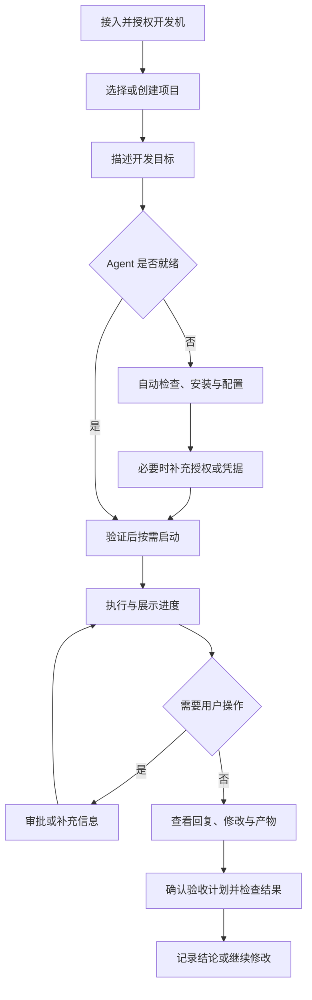

# 01 产品总览

## 1. 执行摘要

### 产品问题与方案

开发者希望随时推动开发任务，却容易被工具安装、运行服务、模型配置、权限处理和跨设备状态同步打断。Omni Code 将这些准备与协作工作整合到自然语言任务流程中，让用户围绕“我要做什么、现在做到哪、结果是否符合预期”操作。

产品以 Codex、Pi 为主要直接接入的 Agent，其他 Agent 通过 ACP 扩展。用户需要时系统自行启动 Agent；用户可让现有 Agent 安装指定 Agent 工具；可推导和可执行的配置尽量由 Agent 完成。

### 产品原则

1. 先任务后配置：用户先表达目标，缺少能力时在原流程补齐。
2. 自动处理可确定的步骤：已有配置可用就复用，只询问无法推导的信息。
3. 用户始终知道发生什么：展示阶段、等待原因、必要动作和结果。
4. 失败可继续：保留输入、已完成步骤和上下文，不要求反复重来。
5. 权限与结果明确：自动化遵守授权；准备完成、执行完成和验收通过分别表达。

### 成功标准

以下为发布验收目标，实际值随版本验收记录更新。

| 指标 | 目标 |
| --- | --- |
| 已就绪环境免配置 | 选择项目并发送需求即可执行，强制填写技术配置项为 0 |
| 标准准备流程 | 支持清单内 Agent 无需手改配置文件；用户只提供必要授权、凭据或选择 |
| 核心流程成功率 | 发布范围内连接、准备、执行、审批、恢复用例全部通过 |
| 幂等与隔离 | 重试不重复执行；宿主机、身份、项目、会话之间无数据串用 |
| 可恢复与可追溯 | 每次失败可定位阶段，每次验收可定位被测版本、计划、证据与最终结论 |

## 2. 用户体验与功能

### 用户与任务

| 用户 | 核心任务 |
| --- | --- |
| 开发任务发起者 | 从手机或桌面表达需求、查看进度、补充信息、处理审批 |
| 开发环境所有者 | 接入开发机、管理设备授权、工具与模型连接 |
| 结果验收者 | 确认检查计划、查看结果与证据、必要时接管操作 |

这些是使用角色，不引入组织或团队账号体系。首批用户熟练程度待定；核心流程不要求理解协议或编辑配置文件。

### 端到端旅程

### 关键用户故事

| 故事 | 验收归属 |
| --- | --- |
| 作为用户，我希望连接开发机后直接发任务，以便跨设备继续工作 | WS、SS |
| 作为用户，我希望使用 Codex/Pi，其他工具按需添加，以免面对复杂接入设置 | AG、TG |
| 作为用户，我希望系统自动启动并配置工具，以减少准备工作 | TG |
| 作为用户，我希望知道操作风险并作出授权，以控制宿主机变更 | AP |
| 作为用户，我希望用语音输入并收到重要提醒，以便离开电脑也能推进任务 | SP、ST |
| 作为用户，我希望验证实际修改并查看证据，以判断交付是否满足需求 | AT |

验收条件分别在对应模块定义。功能状态集中见 07，不混入用户主流程。

### 信息架构与交互规范

- 首页：连接状态、需处理事项、最近项目和会话、搜索、新任务。
- 项目：目录与环境摘要、会话、任务结果、验收入口。
- 会话：输入、执行进度、审批、结果、差异与产物；高级参数折叠。
- 工具与设置：Agent/ACP、模型连接、扩展、语音、授权设备和偏好。
- 验收：版本、计划、运行进度、桌面接管、证据、最终结论。

手机优先单任务阅读，桌面支持项目导航与详情并列。加载、空内容、无权限、离线、失败和等待用户分别呈现。状态不能只靠颜色区分；核心操作有可读标签、键盘焦点与屏幕阅读语义。危险操作说明影响范围，输入错误保留已填内容。

### 范围

核心交付覆盖连接、项目、会话、Codex/Pi、ACP 扩展、安装配置、审批与恢复。语音和自动验收可独立分期上线；未就绪能力不展示可执行的误导入口。组织权限、计费、账号自动注册、模型训练和完整 Git 托管不在本轮范围。通用开发工具安装作为后续扩展，先完成 Agent 工具闭环。

## 3. AI 系统要求

编码 Agent 执行开发任务；配置 Agent 完成环境检查、安装配置与诊断；验收 Agent 生成计划、执行检查和提出结论。三类任务均受权限约束，使用工具真实验证结果，不以模型声称成功作为完成依据。

评估包括确定性功能测试、真实 Agent 端到端测试、危险操作与错误环境样本、人工核对的验收样本。无法判断时呈现不确定或阻塞，不自动判通过。模型、版本、费用与外部连接策略可查看；不会为重试静默改用另一个付费服务。

## 4. 技术规格

客户端负责交互、状态同步与本地偏好；Bridge 负责宿主机接入、持久任务、工具调用与配置管理。Codex/Pi 直接适配，其他 Agent 使用 ACP。客户端断开不终止已受理任务。

项目、会话、回合、环境准备任务和验收运行分别有稳定标识；关键变更可追踪。身份与授权、秘密存储、资源限制、数据保留与升级要求统一见 06。

## 5. 风险与路线图

先交付连接与 Codex/Pi 任务闭环，再交付 Agent 自动安装配置和首批 ACP 工具，最后扩展语音与自动验收。每期通过独立发布门槛，不要求为赶进度开放不完整入口。具体工作包和实现状态见 07。

主要风险为平台和版本差异、首次引导依赖模型、自动配置误改、进程中断、ACP 能力不一致与 AI 验收误判。通过支持清单、确定性兜底、权限边界、备份验证、恢复机制和人工结论控制。
