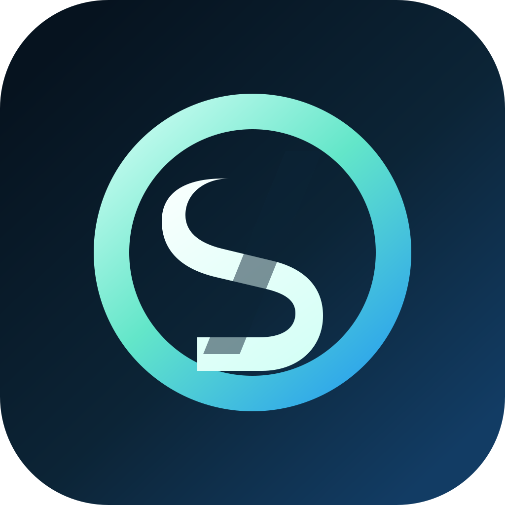
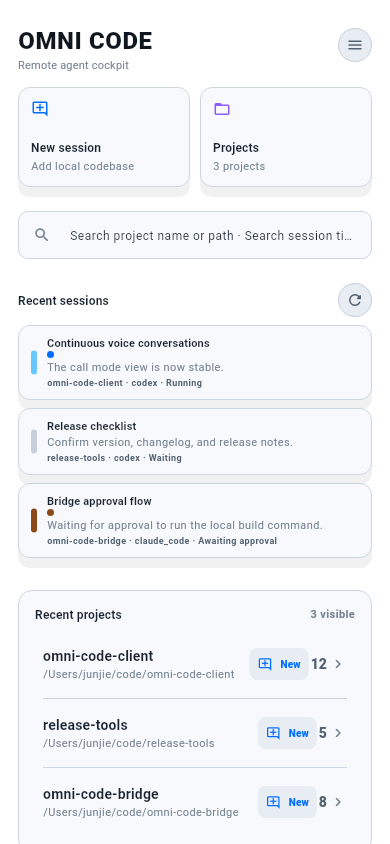
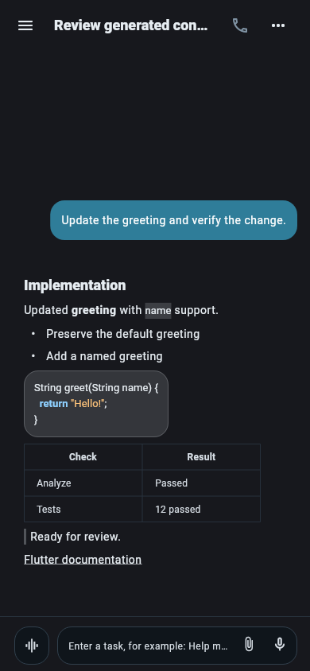
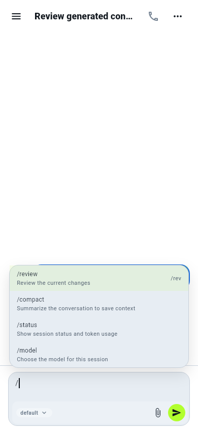

<p align="center">
  
</p>

<h1 align="center">Omni Code Client</h1>

<p align="center">
  <a href="../../LICENSE"></a>
  <a href="https://flutter.dev"></a>
  
  <a href="https://github.com/omni-stream-ai/omni-code/releases"></a>
</p>

<p align="center">
  <a href="../../README.md">English</a>
</p>

---

Omni Code 是一个跨平台 Flutter 客户端，支持桌面端和移动端，核心目标是让你即使在移动端或通过语音，也能完成产品设计、开发、测试等全部工作流。

它连接 [omni-code-bridge](https://github.com/omni-stream-ai/omni-code-bridge)，让桌面 agent 的能力延伸到多端和语音交互中。

参见：[插件编写指南](https://github.com/omni-stream-ai/omni-code-plugins/blob/main/docs/zh/plugin-manifest-guide.md) | [插件仓库](https://github.com/omni-stream-ai/omni-code-plugins)

## 预览

| 工作台 | 会话内容 | 命令建议 |
| :---: | :---: | :---: |
| <a href="../../designs/current/README.md"></a> | <a href="../../designs/current/README.md"></a> | <a href="../../designs/current/README.md"></a> |

当前 Flutter 实际界面 · 移动端与桌面端 · 深浅主题

[浏览完整界面图册 →](../../designs/current/README.md)

## 路线图 (V1)

1. **完善基本交互** — 优化会话、审批、通知等核心流程的体验
2. **跨项目跨会话语音交互** — 用语音在多个项目和会话间无缝切换
3. **任务编排** — 支持多步骤任务的编排与自动化执行

## 安装

| 平台 | 下载 |
| --- | --- |
| Android | [APK (arm64)](https://github.com/omni-stream-ai/omni-code/releases/latest/download/omni-code-android-arm64-v8a.apk) · [APK (arm)](https://github.com/omni-stream-ai/omni-code/releases/latest/download/omni-code-android-armeabi-v7a.apk) · [APK (x86_64)](https://github.com/omni-stream-ai/omni-code/releases/latest/download/omni-code-android-x86_64.apk) |
| Windows | [zip](https://github.com/omni-stream-ai/omni-code/releases/latest/download/omni-code-windows-x86_64.zip) |
| Linux | [AppImage](https://github.com/omni-stream-ai/omni-code/releases/latest/download/omni-code-linux-x86_64.AppImage) · [tar.gz](https://github.com/omni-stream-ai/omni-code/releases/latest/download/omni-code-linux-x86_64.tar.gz) |
| macOS | Homebrew ↓ |
| iOS | 自行编译 |

Linux 下载包面向 x86_64、glibc 2.35 及以上、具备 X11/Wayland 桌面和图形驱动的系统。
两种格式都包含 GTK、WebKit 辅助程序、音频库和 GStreamer 插件；glibc、标准 C/C++
运行库和图形驱动使用系统提供的版本。

AppImage 添加执行权限后即可运行；没有 FUSE 时可使用
`./omni-code-linux-x86_64.AppImage --appimage-extract-and-run`。tar.gz 解压后运行
`./omni-code-linux-x86_64/AppRun`，并保留完整目录。NixOS 请使用下方项目自带的 Nix 包，
普通 Linux 下载包使用的是常规发行版的动态加载器路径。

**Homebrew（macOS）：**

```bash
brew tap omni-stream-ai/homebrew-omni-code
brew install --cask omni-code
```

**Arch Linux（AUR）：**

```bash
yay -S omni-code-bin
```

**Nix / NixOS（x86_64 Linux，默认从源码构建）：**

```bash
nix run github:omni-stream-ai/omni-code
```

也可以明确选择源码或预编译版本：

```bash
nix run github:omni-stream-ai/omni-code#omni-code-bin
nix run github:omni-stream-ai/omni-code#omni-code
```

安装到当前用户的 profile：

```bash
nix profile install github:omni-stream-ai/omni-code#omni-code-bin
# 或从源码构建并安装
nix profile install github:omni-stream-ai/omni-code#omni-code
```

## Relay 远程连接

设置中的 Relay 入口支持设备登录、服务选择，以及通过直连管理电脑端远程访问。使用方式和验证范围见[Relay 远程连接](relay.md)。

## 开发

桌面端支持可自定义并自动保存的[键盘快捷键](keyboard-shortcuts.md)，包括搜索、新窗口、新会话和导航操作。

```bash
flutter pub get
flutter run
```

在 Nix / NixOS 上，使用开发环境加载 Linux 原生依赖：

```bash
nix develop --command flutter run -d linux
```

`nix develop --command flutter build linux --release` 也会修正 bundle 中的原生库，
让本地构建结果能在 NixOS 开发环境之外直接运行；这个 Nix 构建结果不是供其他发行版
使用的通用发布包。

在 Ubuntu 22.04 构建基线上生成两种发布格式：

```bash
bash scripts/install-linux-build-deps.sh
flutter pub get
flutter build linux --release
bash scripts/download-linux-packaging-tools.sh
bash scripts/package-linux.sh
bash scripts/test-linux-release.sh
```

CI 会检查每个 ELF 库的依赖，拒绝超出基线的 glibc 版本要求，并在只安装桌面平台
组件的 Ubuntu 22.04 和 Debian 12 容器中验证两种格式。启动检查要求应用在 Xvfb 中
实际渲染出第一个 Flutter 画面。

## 贡献

参见 [CONTRIBUTING.md](../../CONTRIBUTING.md)。项目 TODO 看板在 [GitHub Projects](https://github.com/orgs/omni-stream-ai/projects/2)。

## 许可证

[MIT](../../LICENSE)
